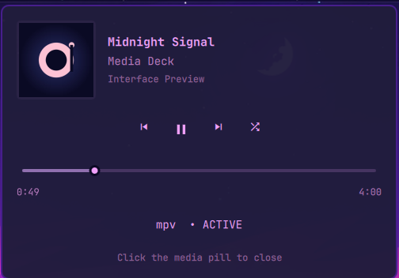

# Media Deck

A media bar widget for [Omarchy](https://omarchy.org/) that keeps now-playing
information in the bar and puts the full media card one click away.

It is a single `bar-widget` plugin built on the standard
[Quickshell](https://quickshell.org/) MPRIS service, so it works with any player
that exposes a normal MPRIS interface.



## Features

- Compact pill in the bar showing play state and the track title
- One click opens a media card with title, artist and album
- Previous, play/pause, next and shuffle controls
- Draggable seek bar with elapsed and total time
- Volume slider and mute control
- Mouse-wheel volume adjustment on the bar pill
- Repeat mode cycling when supported by the player
- Hover tooltip with track and player information
- Player picker when more than one player is available
- Prefers a playing source that reports a real timeline
- Slider is disabled when the current player cannot seek
- Follows the active Omarchy theme automatically
- No extra dependencies

## Requirements

- Omarchy with the current Quickshell-based shell
- A media player that exposes MPRIS (Spotify, VLC, mpv, Elisa, Chromium, and
  most native Linux players)

## Install

```bash
omarchy plugin add https://github.com/Aashutosh31/omarchy-media-deck.git --enable
```

The command asks where to place the widget. Choosing `center` places it beside
the clock, which is how it is designed to look.

Media metadata is rendered as plain text; title, artist and album strings are
not interpreted as HTML or rich text. Displayed metadata is capped at 256
characters per field (player labels at 80) to bound UI work from malformed
player metadata.

Artwork is intentionally not loaded from MPRIS. Even local paths can refer to
blocking special files, and checking a path before opening it would leave a
race. The widget uses a music-note cover placeholder instead; no player-
controlled URL or filesystem path reaches Qt Quick's image loader.

## Use

| Action | Result |
| --- | --- |
| Left click the pill | Open or close the media card |
| Right click the pill | Play / pause |
| Middle click the pill | Next track |
| Scroll over the pill | Adjust player volume |
| Drag the progress bar | Seek in the current track |
| Click a player row | Switch to that player |

The widget hides itself when nothing is playing.

## Player selection

When several players are open, Media Deck picks the best available source in
this order:

1. A playing player that reports duration, position and seek support
2. Any playing player
3. Any player that reports a track title or artist

This matters when a browser and a native player are both open: the widget uses
the one that can actually provide a timeline.

## Known limitations

- **Firefox / YouTube Music:** Firefox's current MPRIS bridge reports
  `PlaybackStatus: Playing` and `CanSeek: true`, but returns `Position: 0` and no
  track length. A truthful progress bar and seeking are therefore not possible
  for that source. Play/pause, previous and next still work. Chrome, Chromium
  and native players expose the timeline correctly.
- Seeking is disabled when the player does not report seek or length support,
  rather than showing a slider that would not do anything.
- Position and length are read in seconds, matching Quickshell's
  `MprisPlayer` contract.
- Cover art is not displayed. Playback controls and timeline support are
  unaffected.

## Removal

```bash
omarchy plugin remove aashutosh31.media
```

This disables the plugin and removes its folder. It does not touch your
dotfiles or any other settings outside the plugin itself.

## License

MIT. See [LICENSE](LICENSE).
